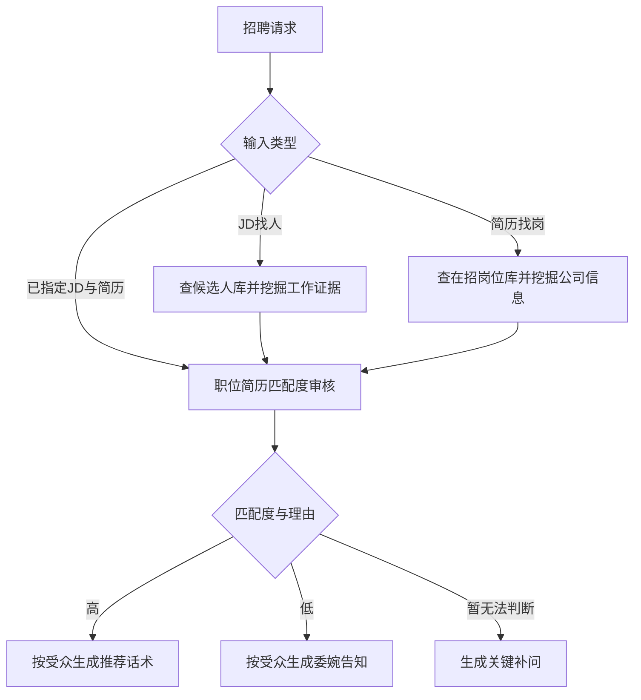

# Fanhan Agentic Talent Recruiting

**泛函 Agentic 人才招聘**：由统一入口与独立子 Skill 组成的招聘能力合集。

给出公司、职位和候选人的真实材料，Agent会选择双向查库或单对审核，补充与匹配有关的信息，再按受众生成推荐、委婉告知或补问话术。当前合集版本：**0.2.1**。

## 能力目录

| Skill | 输入与任务 | 输出 |
|---|---|---|
| [泛函 Agentic 人才招聘](skills/fanhan-agentic-talent-recruiting/SKILL.md) · `fanhan-agentic-talent-recruiting` | 招聘问题、已有材料或需要衔接多个步骤 | 选择适用子 Skill 并执行 |
| [职位简历匹配度审核](skills/job-resume-match-audit/SKILL.md) · `job-resume-match-audit` | 公司介绍 + 一个JD + 一位候选人的简历及相关信息；可指定受众 | 匹配度与理由；高匹配推荐、低匹配委婉告知或待确认补问 |
| [职位 & 简历智能匹配](skills/job-resume-intelligent-matching-fanhan/SKILL.md) · `job-resume-intelligent-matching-fanhan` | JD查候选人库；简历查在招岗位库；批量检索排序 | 相关信息挖掘、审核后排序及公司版/候选人版话术 |

JD找人时挖掘候选人的工作证据，向公司推荐候选人；简历找岗时取得公司资料与完整JD，挖掘相关业务信息，向候选人推荐公司和岗位。两条路径在正式推荐前使用同一个审核子 Skill。已指定组合时直接审核。



## 安装

通过 Skills CLI 选择当前使用的Agent并安装所需能力：

```bash
npx skills add Ivor-NCUT/fanhan-agentic-talent-recruiting
```

只需要单对审核时：

```bash
npx skills add Ivor-NCUT/fanhan-agentic-talent-recruiting --skill job-resume-match-audit
```

安装整个合集时选中三个 Skill。入口名称以宿主实际显示为准；主入口与子 Skill 都可直接使用。
本仓库也提供 `.claude-plugin/` 清单，统一登记同一组能力。

## 怎样使用审核 Skill

把以下材料放在同一请求里，或引用当前对话已经提供的材料：

```text
使用「职位简历匹配度审核」，判断这个候选人和这个职位是否匹配。

公司介绍：业务、客户、产品阶段、团队背景。
JD：完整职责、必须条件、加分项、工作方式。
候选人简历：经历、项目、个人贡献、技能与成果。
相关信息：求职类型、地点与迁移意愿、到岗、薪资、作品或沟通记录。
话术受众：公司 / 候选人（可选；未指定时给双方草稿）。
```

先给匹配度和结论，再逐项核对要求与证据，并交付适用话术：

| 匹配度 | 结论与话术 |
|---|---|
| 高 | 必须条件与核心任务有证据支持；生成推荐话术。 |
| 低 | 明确必须条件不符或核心任务有决定性差异；生成委婉告知。 |
| 暂无法判断 | 关键证据不足；给补问，不当作拒绝。 |

证据置信度单独用高/中/低说明，不能当成匹配度或录用概率。默认不生成百分制审核分数，初筛高分不能覆盖硬条件。缺少加分项不会自动否定匹配。用户只要审核结论时可省略话术。

审核区分简历自述、沟通确认与外部核验。公司背景只用于解释工作任务，不新增隐性门槛。生成的是草稿，不自动联系、发送、上传简历或写回数据库。

## 匹配结束后的话术

0.2.1参考业务沟通指南，完善两个子 Skill 的末尾话术：

- **推荐**：连接具体公司业务、岗位任务与候选人贡献。多岗位先给最多五个短选项；已选岗位提供完整JD与已有公司信息。
- **委婉告知**：只解释本次岗位的决定性差异，不评价整体能力，不冒充企业拒绝，不承诺未安排的持续跟进。
- **补问**：只问最多三个影响判断的缺口。关键城市意愿或实战证据未知时先确认，不混进高匹配推荐。
- **沟通衔接**：感兴趣与同意向具体公司、岗位推荐材料分别处理。已有适用同意且未撤回时沿用；未知时生成确认草稿。准备好推荐与实际发送分别表述。

具体规则与模板见[招聘推荐与审核话术](skills/job-resume-match-audit/references/recruiting-copy.md)。审核草稿与对外话术分开；查库失败不能写成没有合适人选。实际向公司交付身份或简历需要候选人适用同意及发送授权。

## 现有批量匹配与兼容性

原 Skill 名称 `job-resume-intelligent-matching-fanhan` 保留，原批量命令仍可用：

```bash
python scripts/run_match.py --input input.json --output matches.json --top-n 5
```

实现、字段映射、输入输出Schema和原评测已放到独立能力包中：

- [匹配脚本](skills/job-resume-intelligent-matching-fanhan/scripts/run_match.py)
- [Base字段映射](skills/job-resume-intelligent-matching-fanhan/references/base-field-mapping.md)
- [输入Schema](skills/job-resume-intelligent-matching-fanhan/schemas/match-input.schema.json)
- [输出Schema](skills/job-resume-intelligent-matching-fanhan/schemas/match-output.schema.json)

轻量脚本读取本地JSON，两个方向都排除明确的实习/正职冲突，反向匹配也使用已知类别门控；类别未知时保留待复核提示。其语义分仍是关键词/长度代理，LLM分仍是算术占位。查库、主动信息挖掘、当前招聘状态验证、完整审核和话术生成由Agent按Skill执行，脚本本身不执行这些步骤；Top-N不能直接当作已审核的推荐名单。

## 目录与验证

```text
skills/
  fanhan-agentic-talent-recruiting/       # 薄路由入口
  job-resume-match-audit/                # 单对匹配审核
  job-resume-intelligent-matching-fanhan/ # 原有双向匹配
scripts/run_match.py                    # 原命令兼容入口
tests/                                  # 现有逻辑及目录、路由与兼容验证
.claude-plugin/                          # 合集清单
```

```bash
python -m unittest discover -s tests -v
```

审核的合成案例位于 [evals/evals.json](skills/job-resume-match-audit/evals/evals.json)，匹配案例位于[匹配evals](skills/job-resume-intelligent-matching-fanhan/evals/evals.json)。案例定义覆盖硬条件、信息不足、双向信息挖掘、推荐与告知、已有推荐同意及读取失败话术；案例文件存在不代表已完成真实数据库或模型评测。真实招聘质量需实际材料验收。

## 架构参考

参考 [dontbesilent2025/dbskill](https://github.com/dontbesilent2025/dbskill/tree/f24ea08ae4b50660a1575554eb58903fa6d60f01) 的独立 `skills/` 目录、导航入口与能力清单组织方式。子 Skill 内容、路由文案与测试为本仓库编写；未复制其商业知识、指令正文或更新系统。
