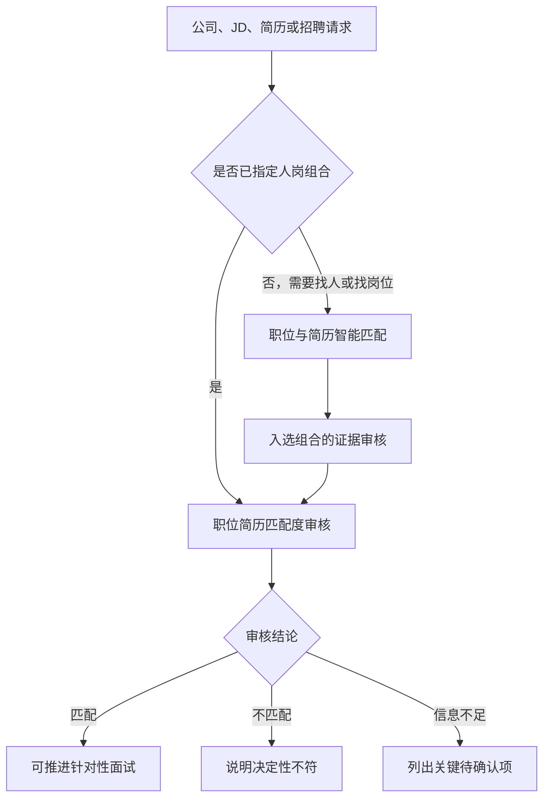

# Fanhan Agentic Talent Recruiting

**泛函 Agentic 人才招聘**：由统一入口与独立子 Skill 组成的招聘能力合集。

给出公司、职位和候选人的真实材料，Agent会选择检索匹配或单对审核，在当前对话中完成所需结果。合集保留原有双向匹配能力，新增「职位简历匹配度审核」。

## 能力目录

| Skill | 输入与任务 | 输出 |
|---|---|---|
| [泛函 Agentic 人才招聘](skills/fanhan-agentic-talent-recruiting/SKILL.md) · `fanhan-agentic-talent-recruiting` | 招聘问题、已有材料或需要衔接多个步骤 | 选择适用子 Skill 并执行 |
| [职位简历匹配度审核](skills/job-resume-match-audit/SKILL.md) · `job-resume-match-audit` | 公司介绍 + 一个JD + 一位候选人的简历及相关信息 | 匹配／不匹配／信息不足，待确认；证据、硬条件与下一步 |
| [职位 & 简历智能匹配](skills/job-resume-intelligent-matching-fanhan/SKILL.md) · `job-resume-intelligent-matching-fanhan` | 简历找岗位、JD找候选人、批量检索排序 | 有证据的排序、候选人话术或企业推荐交付 |

已指定人岗组合时直接审核，不再扫描候选库。检索的高分不代表审核通过；正式推荐前核对选中的人岗组合。



## 安装

通过 Skills CLI 选择当前使用的Agent并安装所需能力：

```bash
npx skills add Ivor-NCUT/fanhan-agentic-talent-recruiting
```

只需要单对审核时：

```bash
npx skills add Ivor-NCUT/fanhan-agentic-talent-recruiting --skill job-resume-match-audit
```

安装整个合集时选中三个 Skill。入口名称以宿主实际显示为准；主入口与子 Skill 都可直接使用。
本仓库也提供 `.claude-plugin/` 清单，统一登记同一组能力。

## 怎样使用审核 Skill

把以下材料放在同一请求里，或引用当前对话已经提供的材料：

```text
使用「职位简历匹配度审核」，判断这个候选人和这个职位是否匹配。

公司介绍：业务、客户、产品阶段、团队背景。
JD：完整职责、必须条件、加分项、工作方式。
候选人简历：经历、项目、个人贡献、技能与成果。
相关信息：求职类型、地点与迁移意愿、到岗、薪资、作品或沟通记录。
```

结论先给出，再逐项核对要求与证据。明确违反必须条件时判不匹配；关键证据不足时给待确认，不编造已具备的能力。缺少加分项不会自动否定匹配。

审核区分简历自述、沟通确认与外部核验。公司背景只用于解释工作任务，不新增隐性门槛。不自动联系候选人、发送报告或写回数据库。

## 现有批量匹配与兼容性

原 Skill 名称 `job-resume-intelligent-matching-fanhan` 保留，原批量命令仍可用：

```bash
python scripts/run_match.py --input input.json --output matches.json --top-n 5
```

实现、字段映射、输入输出Schema和原评测已放到独立能力包中：

- [匹配脚本](skills/job-resume-intelligent-matching-fanhan/scripts/run_match.py)
- [Base字段映射](skills/job-resume-intelligent-matching-fanhan/references/base-field-mapping.md)
- [输入Schema](skills/job-resume-intelligent-matching-fanhan/schemas/match-input.schema.json)
- [输出Schema](skills/job-resume-intelligent-matching-fanhan/schemas/match-output.schema.json)

轻量脚本用于初步排序。其语义分是关键词与文本长度的代理计算，LLM分是算术占位，不能替代完整硬条件审核；输出Top-N不能直接当作已通过审核的企业推荐名单。

## 目录与验证

```text
skills/
  fanhan-agentic-talent-recruiting/       # 薄路由入口
  job-resume-match-audit/                # 单对匹配审核
  job-resume-intelligent-matching-fanhan/ # 原有双向匹配
scripts/run_match.py                    # 原命令兼容入口
tests/                                  # 现有逻辑及目录、路由与兼容验证
.claude-plugin/                          # 合集清单
```

```bash
python -m unittest discover -s tests -v
```

审核的合成案例位于 [evals/evals.json](skills/job-resume-match-audit/evals/evals.json)。它们覆盖明确硬条件不符、关键证据不足和有依据的匹配；真实招聘质量仍需实际材料验收。

## 架构参考

参考 [dontbesilent2025/dbskill](https://github.com/dontbesilent2025/dbskill/tree/f24ea08ae4b50660a1575554eb58903fa6d60f01) 的独立 `skills/` 目录、导航入口与能力清单组织方式。子 Skill 内容、路由文案与测试为本仓库编写；未复制其商业知识、指令正文或更新系统。
